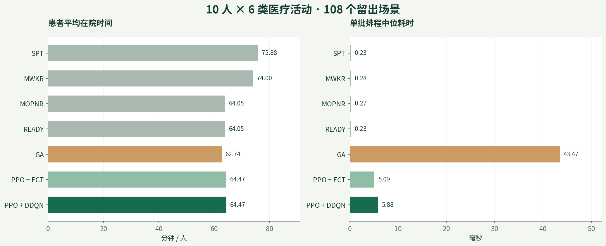
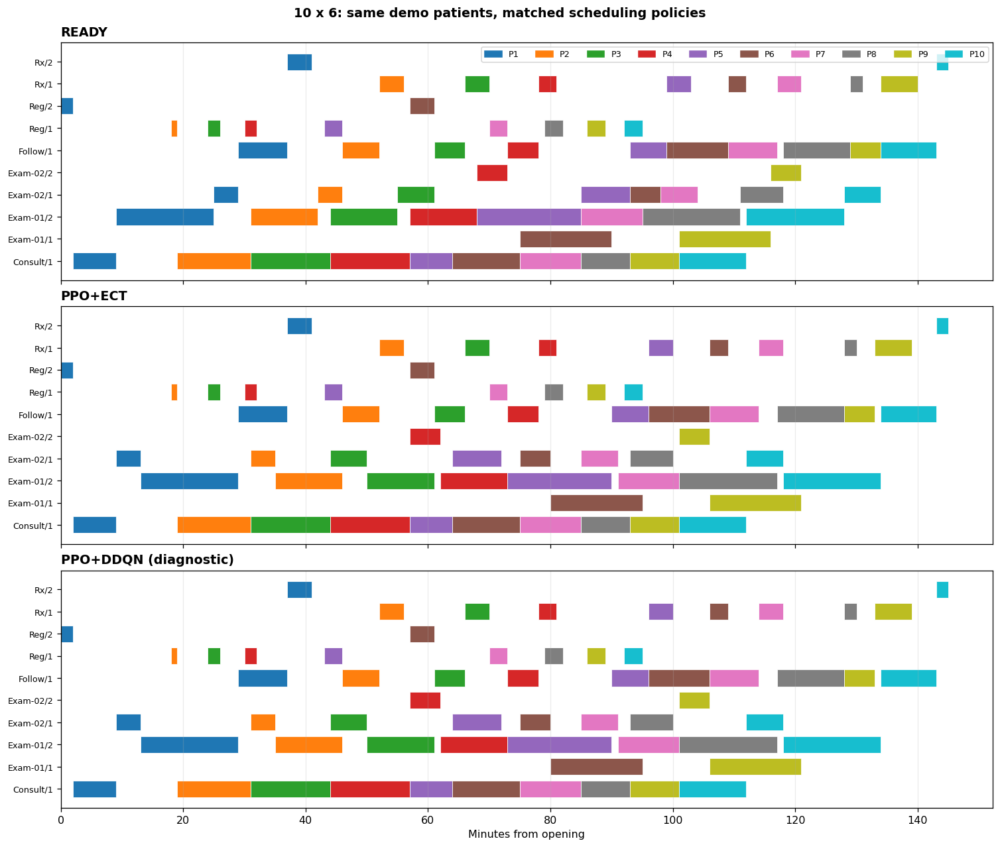

# 门诊多窗口智能调度

**图状态建模 · 双智能体决策 · 留出集对照 · 患者级互动回放**

[项目概述](#项目概述) · [实验结果](#实验结果) · [互动回放](#互动回放) · [复现与文件](#复现与文件)

## 项目概述

门诊就诊路径包含挂号、初诊、多项检查、复诊和取药。不同患者竞争有限的服务窗口，检查项目还具有前置关系和可选执行顺序。项目以**最小化患者总在院时长**为目标，构建同时约束患者活动与窗口资源的排程环境，并将决策结果转化为患者级、窗口级可追溯的交互作品。

方案以图结构描述活动关系和资源占用，由 **PPO 选择下一项患者医疗活动**，由 **DDQN 在合格窗口中分台**。所有对照方法共用同一批病例、窗口资格及空档插入规则。独立审计覆盖任务完整性、到达时间、服务时长、诊疗前置关系、患者冲突与窗口冲突。

| 研究与工程环节 | 本项目实现 |
| --- | --- |
| 排程环境 | 合成病例、医疗活动前置图、患者互斥、窗口互斥、窗口空档插入 |
| 活动决策 | 图状态特征、PPO 更新、从自身排程状态生成动作排序训练样本 |
| 窗口决策 | DDQN、候选窗口屏蔽、窗口占用对其他就绪活动的影响特征 |
| 对照评测 | READY、SPT、MWKR、MOPNR、GA、PPO＋ECT及扩展策略 |
| 交互呈现 | 模拟时钟、患者轨迹、窗口候诊、甘特图、逐事件跳转与策略切换 |

初诊和复诊各固定一个窗口。挂号、检查及取药支持 1、2、3 个候选窗口。训练状态、验证选优及正式留出集分别管理，排程推断耗时与训练耗时分别记录。

## 实验结果

### 评测设计

本次完整复跑覆盖 **6×6 与 10×6** 两种规模。第一个数字为患者数，第二个数字为医疗活动种类。每种规模组合 3 档窗口配置、3 类客流和 12 个重复病例，共 **108 个留出场景**。两种规模合计 **216 个场景**，每场景对照 8 种策略，形成 **1,728 份排程**，全部通过可行性审计。

PPO 在独立验证集上先选优，再以同一 PPO 权重训练 DDQN。两种规模的 PPO 验证结果均未达到 READY 门槛，本次启用了 DDQN 诊断训练，各完成 300 轮，表格据实保留“诊断”标记。PPO 初训预算为 180 轮，另有 10 轮自身排程动作排序训练。GA 使用 20 个体、15 代，由 READY、SPT、MWKR、MOPNR 四条规则提供初始可行解。

### 10×6 留出集表现

| 策略 | 平均在院时间（分钟/人） | P90 累计等待（分钟） | 单批排程中位耗时（ms） |
| --- | ---: | ---: | ---: |
| READY | 64.045 | 23.831 | 0.230 |
| SPT | 75.877 | 62.906 | 0.235 |
| MWKR | 73.996 | 57.170 | 0.276 |
| MOPNR | 64.045 | 23.831 | 0.265 |
| GA | 62.737 | 25.609 | 43.474 |
| PPO+ECT | 64.465 | 24.139 | 5.092 |
| PPO+ECT+压力平局 | 64.465 | 24.139 | 5.302 |
| PPO+DDQN（诊断） | 64.465 | 23.997 | 5.876 |

在 108 个 10×6 留出场景中，PPO＋DDQN 诊断组的患者平均在院时间较 SPT 缩短 **15.0%**、较 MWKR 缩短 **12.9%**。单批排程中位耗时由 GA 的 **43.474 ms** 降至 **5.876 ms**，下降 **86.5%**，对应约 **7.40 倍**的排程速度。

本次 GA 的患者平均在院时间更低，双智能体诊断组较 GA 高 **2.8%**。结果同时展示解质量与计算成本之间的权衡。耗时为当前实验环境下的实测，复跑时会随硬件、负载和计时抖动变化。

完整记录见 [结果汇总](results_summary.csv)、[逐场景指标明细](instance_outcomes.csv)、[策略配对汇总](paired_comparisons.csv) 和 [验证集选优记录](validation_selection.csv)。README 表格与 CSV 均提取自随附 [已执行 Notebook](outpatient_experiment.ipynb) 的本次输出，数值精度保留至三位小数。逐场景指标明细由拆分脚本完整复跑导出，保留患者时间与可行性指标。

### 同批患者的窗口排程

下图记录同一批 10 名患者的服务时段。色块对应患者，横轴为开诊后分钟数，纵轴为具体服务窗口。

[查看 6×6 排程图](gantt_6x6.png) · [查看验证集训练曲线](training_curves.png)

## 互动回放

互动页面以 **10 名患者、每类检查 3 个窗口**为默认场景，支持在 6 人与 10 人、1–3 个窗口及四种策略之间切换。模拟时钟从 09:00 开始，患者状态、窗口占用、个人轨迹和甘特图随时间联动。

- **全局观察**。同时显示累计到达、正在候诊、正在服务和已离院人数，窗口卡片展示当前患者及分配到该窗口的候诊患者。
- **患者追踪**。点击患者卡片或服务色块，查看该患者每项活动的就绪、开始、结束与等待时长，并与指定对照策略比较。
- **事件定位**。支持播放、暂停、倍速、时间轴拖动和逐事件跳转，在同一模拟时刻切换策略。
- **窗口决策核验**。10×6 三窗口示例共有 60 项活动，DDQN 实际执行 40 次三选一分台，单窗口场景的分台次数为 0。

**[获取离线互动页面](index.html)**。在 GitHub 文件页下载 HTML，用浏览器打开即可操作。页面内含完整展示数据，可离线使用。Python 代码负责生成病例、求解与校验，HTML 负责呈现已计算的排程。

[回放数据](replay_data.json) 与 [服务排程明细](replay_schedules.csv) 覆盖两个规模、三档窗口配置和四种展示策略，共 24 份示例排程。状态快照为同一组数据生成的静态视图。示例页面的单批结果与留出集整体结果按各自口径报告。

## 复现与文件

所有交付文件位于仓库根目录，图片、CSV、Python 模块及 Notebook 直接使用相对文件名链接。

| 文件 | 内容 |
| --- | --- |
| [outpatient_experiment.ipynb](outpatient_experiment.ipynb) | 完整代码、实际执行输出、对照表与内嵌互动回放 |
| [scheduling.py](scheduling.py) | 病例、排程、空档插入、规则、GA及独立约束审计 |
| [agents.py](agents.py) | 图状态编码、PPO、DDQN与推断提速实现 |
| [training.py](training.py) | 训练、验证选优、断点恢复与动作排序训练 |
| [run_experiment.py](run_experiment.py) | 完整实验入口及命令行规模、预算配置 |
| [replay.py](replay.py) | 分台调用核验、事件导出及自包含 HTML 页面生成 |
| [verify_core.py](verify_core.py) | 精确小例、窗口插空、提速前后等价性及大图可行性核验 |
| [requirements.txt](requirements.txt) | 本次复跑所使用的 Python 依赖版本 |

建议使用 Python 3.12。在仓库目录安装依赖并运行默认实验。

    python -m pip install -r requirements.txt
    python run_experiment.py

默认同时训练、评测 6×6 和 10×6，运行产物写入本地 hospital_latest_results 目录。目录包含权重、训练日志、逐病例结果、图片和互动页面。完整 Notebook 也可使用已安装依赖的内核运行全部单元格。

    python verify_core.py
    python run_experiment.py --scope 10x6
    python run_experiment.py --scope all --profile paper_budget

全规模入口覆盖论文中的大小规模组合，包含 30×20、50×20、100×20 的迁移评测。论文预算配置将 PPO 训练提升至 10,000 轮。全规模入口的结果取决于实际运行完成后的输出，本仓库首页记录范围为两组小规模留出集。核心核验中的 50、100 人测试用于确认大图路径可生成可行排程。

## 研究依据与适用范围

研究依据为 *Outpatient scheduling problem in smart hospital with two-agent deep reinforcement learning algorithm*，Discover Computing 27, 41（2024）。[论文 DOI](https://doi.org/10.1007/s10791-024-09474-1)

本仓库为基于论文思路的重建实验及交互原型，使用自建合成病例、窗口状态扩展和动作排序训练。实际医院还需提供患者行为、医护资源、检查时长及系统接口等业务条件后开展验证。报告中的可行性通过率针对仿真约束，所有结果均按本次训练预算与评测范围解释。
